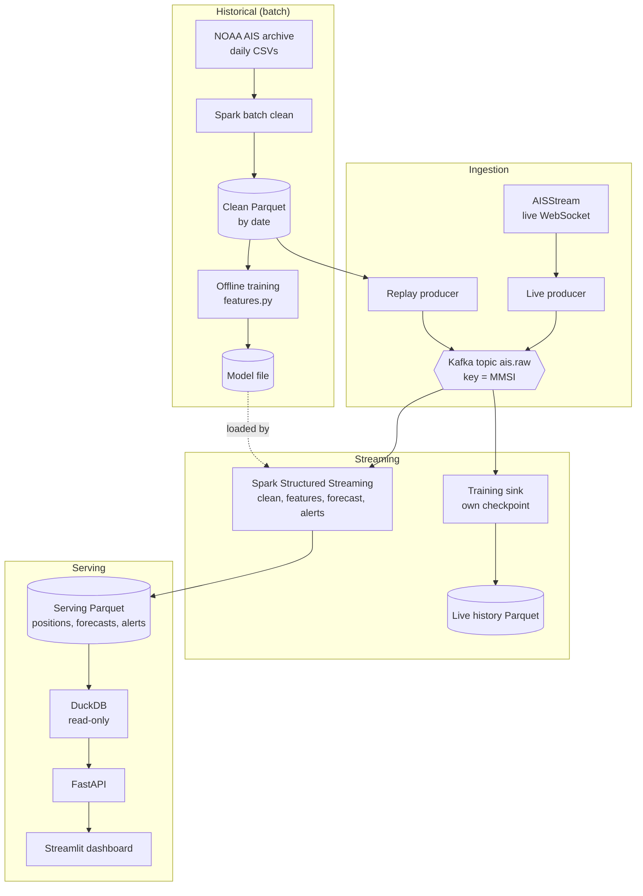

# NY Harbor Vessel Traffic Analytics: Project Plan

Course project for AAI 627 Big Data Analytics for Engineering Design (Fall 2026), Option 1: build a big data analytics app. Due in the first week of December 2026 (exact date unconfirmed).

## 1. Summary

A transportation analytics web app that tracks ship traffic in New York Harbor using public AIS data (the position reports vessels broadcast). A Spark pipeline cleans historical data from NOAA's open archive and a live AIS feed, then forecasts vessel arrivals and flags anomalies (signal gaps and off-route movement). Results appear on a dashboard with a live map, an arrival forecast, and an alert feed.

Analytics tasks covered: data cleaning, time-series forecasting, anomaly detection. Application area: transportation analytics.

## 2. Goals and Non-Goals

**Goals**
- A Spark batch pipeline that turns raw NOAA AIS data into clean, date-partitioned Parquet.
- A Kafka-based streaming path where live and replayed data share one topic and one consumer.
- An hourly arrival forecast evaluated against a seasonal-naive baseline on held-out data.
- Signal-gap and off-route alerts, with detection and false-alert rates measured on injected anomalies.
- A dashboard (live map, forecast chart, alert feed) working end to end.

**Non-goals**
- Collision avoidance, ETA prediction for individual vessels, or anything safety-critical.
- Production deployment, multi-node Spark clusters, or Kubernetes. (One small demo server for the public link is in scope since Nov 11; see week 4.)
- Online (continuous) model learning and model-registry tooling.

## 3. Definitions (draft, finalize in week 1 from the data profile)

| Term                                    | Draft definition                                                                                                                                                                                                                                                                                                                                                                                                                                                                                                                                                                                                                                                                                                                                                                                                                                                                                                                            | To calibrate                                                                                                                                                                                                                                                                                                                                                                                                                                                                                                                                                                                                                                                                                                                                                                                                                                                                                                                                                                                                                                                                                                                                                                                                                 |
| :-------------------------------------- | :------------------------------------------------------------------------------------------------------------------------------------------------------------------------------------------------------------------------------------------------------------------------------------------------------------------------------------------------------------------------------------------------------------------------------------------------------------------------------------------------------------------------------------------------------------------------------------------------------------------------------------------------------------------------------------------------------------------------------------------------------------------------------------------------------------------------------------------------------------------------------------------------------------------------------------------ | :--------------------------------------------------------------------------------------------------------------------------------------------------------------------------------------------------------------------------------------------------------------------------------------------------------------------------------------------------------------------------------------------------------------------------------------------------------------------------------------------------------------------------------------------------------------------------------------------------------------------------------------------------------------------------------------------------------------------------------------------------------------------------------------------------------------------------------------------------------------------------------------------------------------------------------------------------------------------------------------------------------------------------------------------------------------------------------------------------------------------------------------------------------------------------------------------------------------------------- |
| Harbor area                             | Bounding box around New York Harbor and its approaches                                                                                                                                                                                                                                                                                                                                                                                                                                                                                                                                                                                                                                                                                                                                                                                                                                                                                      | Box coordinates from the data profile                                                                                                                                                                                                                                                                                                                                                                                                                                                                                                                                                                                                                                                                                                                                                                                                                                                                                                                                                                                                                                                                                                                                                                                        |
| Geofence (dropped)                      | Polygons around container terminals: Port Newark-Elizabeth and Port Jersey (Bayonne), chosen Nov 6                                                                                                                                                                                                                                                                                                                                                                                                                                                                                                                                                                                                                                                                                                                                                                                                                                          | Terminal arrivals were the first forecast target but too sparse (0.28 per hour at Newark), so the forecast moved to gates and the terminals were removed the same day (polygons in git history)                                                                                                                                                                                                                                                                                                                                                                                                                                                                                                                                                                                                                                                                                                                                                                                                                                                                                                                                                                                                                              |
| **Gate crossing** (the forecast target) | A gate is a line across a harbor entrance (`gates` in `config.yaml`): the sea entrance (Sandy Hook to Rockaway Point), the Narrows, the East River at Throgs Neck, the Hudson at the George Washington Bridge. A crossing is two consecutive reports of a vessel, at most 30 min apart, whose straight track crosses the line; "in" if it ends on the harbor side. Rule in `pipeline/gates.py`. Forecast target: inbound cargo ships and tankers (AIS 70-89) at the sea entrance per hour; every gate, direction, and vessel group is counted, so week 4 can test other targets                                                                                                                                                                                                                                                                                                                                                             | Decided Nov 6 from 58 days. Sea entrance: cargo crossings balance (474 in, 474 out), and extending any line by 25% adds no cargo ships or tankers, so the lines seal their channels. Target: 11.9 inbound ships per day, 0.49 per hour, 63% of hours zero. Tankers count here (refinery traffic), unlike at the terminals (bunker barges). About 3% of crossings are a vessel re-crossing within 10 min (pilot boats), left in. Earlier draft: terminal arrivals (cargo ships entering a geofence after 2 h outside: 384 at Newark in 58 days)                                                                                                                                                                                                                                                                                                                                                                                                                                                                                                                                                                                                                                                                               |
| Forecast target                         | Inbound cargo ships and tankers per hour at the sea entrance gate                                                                                                                                                                                                                                                                                                                                                                                                                                                                                                                                                                                                                                                                                                                                                                                                                                                                           | Hourly or 3-hour bins, and which vessel groups (week 4). Baseline Nov 11: hourly MAE rewards forecasting zero (0.49, against 0.59-0.68 for the baselines); with 3-hour bins (mean 1.48 ships, 27% zero) it does not. Choice pending                                                                                                                                                                                                                                                                                                                                                                                                                                                                                                                                                                                                                                                                                                                                                                                                                                                                                                                                                                                          |
| **Signal gap**                          | A Class A vessel (it reports a navigational status) that was reporting regularly (at least 5 reports in the 15 minutes before) goes silent longer than its threshold: the larger of a minimum for its state and 8 times the median of its last 10 report intervals. State comes from speed, not status: moving at 1 knot or more (minimum 10 min), otherwise stopped, which includes anchored and moored (minimum 30 min). Skip vessels last seen within 2 km of the harbor box edge (they probably left). Raise a gap only while the feed is alive: never past the end of the data, and never across a feed outage (a minute with under 25% of the day's median reports per minute). Each gap is labeled moving or stopped, keeps the declared status, and is labeled `known_spot` if it starts at a shutdown spot: a grid cell (0.002°, about 200 m) where at least 2 vessels went silent for an hour or more and reappeared within 200 m | Decided Nov 6 from 2 NOAA days: status is unreliable (most "under way" gaps were vessels doing under 1 knot); Class B reports never carry a status (checked on 1.3 M rows of a 2023 day); 69 of 78 gaps near the edge were vessels seen just outside the box. Recalibrated Nov 6 on 58 days (10,426 gaps from 839 vessels before the two additions): the NOAA archive has 1,134 outage minutes (worst 8 h on 2023-03-08; a short one most days just after 06:00 UTC), and 2,544 gaps (24%) overlapped one. 94% of the remaining stopped gaps ended within 200 m of where they started (ferries and tour boats switching AIS off at the berth, median about 10 h). Shutdown spots on a time split (learned from 2023, applied to the 16 days of 2024): 87% of berth shutdowns (1,631 of 1,877) labeled, 89% of moving gaps that ended elsewhere (314 of 351) left unlabeled; about 48 unlabeled gaps per day remain. The state minimums and the 8x multiplier were kept: NOAA intervals are about 70 s moving and 180 s moored, so the multiplier rarely raises a threshold there. The box edge check (Nov 6) found no reception drop near the edges, so the 2 km edge rule stays and the 10 km margin fallback is not needed |
| **Off-route** | A cargo ship or tanker under way (2 knots or more) in a grid cell (0.005°, about 560 by 420 m) where no cargo ship or tanker moved, in that cell or its 8 neighbours, during the training days (before the split). Consecutive flagged reports of one ship, at most 30 min apart, are one alert. Rule in `models/offroute.py`, parameters in `config.yaml` (`offroute`) | Decided Nov 11 on the test days (74,032 checked reports): 0.21% flagged, 14 alerts in 15 days (0.9 a day) from 7 ships. Pleasure boats, tugs, and ferries are not checked (they go anywhere or keep their own routes), nor are moored and anchored ships (a rarely used berth is not off-route). 0.002° cells flag 2-8 times as many reports; 0.01° cells would miss a track shifted by about 1 km. A density count threshold (ships per cell) replaced the planned percentile: it is easier to explain and the data had a clear choice. 9 of the 14 alerts are three city wastewater tankers on an East River run that the training days never show, a gap in history coverage rather than an anomaly. The "far from a learned lane" variant was not needed |

**Cleaning rules (draft, log row counts after each)**
1. Crop to the harbor bounding box first.
2. Drop rows with a missing or unparseable timestamp, MMSI, lat, or lon.
3. Drop invalid MMSIs (not 9 digits, or a non-vessel prefix such as base stations and aids to navigation).
4. Drop out-of-range positions (lat outside [-90, 90], lon outside [-180, 180]).
5. Set AIS "not available" codes to null: heading 511, speed over ground 102.3, course over ground 360.
6. Drop exact duplicates on (MMSI, timestamp).
7. Drop position spikes: a report whose implied speed from both the previous and the next report exceeds a threshold (calibrate from the profile). Checking both sides drops only the bad report, not the good one after it.

## 4. Architecture



Three paths share one cleaning and feature module (`pipeline/clean.py`, `pipeline/features.py`):
1. **Historical:** NOAA files are cleaned in batch into Parquet, which feeds offline training and the replay producer.
2. **Streaming:** the live and replay producers write the same message schema to `ais.raw`; one Spark streaming job cleans it, scores it with the trained model, and writes results to serving Parquet.
3. **Serving:** DuckDB reads the serving Parquet read-only; FastAPI and Streamlit sit on top.

| Component | Role |
| :-- | :-- |
| Live producer | Connects to the AIS WebSocket and publishes each message to `ais.raw` |
| Replay producer | Reads clean Parquet and publishes at accelerated speed; makes demos and anomaly tests reproducible |
| Kafka | Single broker, one topic `ais.raw` (3 partitions, key = MMSI), optional `ais.alerts` |
| Spark Structured Streaming | Consumes `ais.raw`, applies the **same cleaning and feature code** as the batch job, writes positions, forecasts, and alerts to serving Parquet |
| Training sink | A second streaming query with its own checkpoint (Spark tracks Kafka offsets in checkpoints, not consumer groups) that stores live history as Parquet for later retraining |
| Offline training | Reads features built from clean historical Parquet with the shared `features.py`; never reads Kafka |
| DuckDB | Queries the serving Parquet read-only. DuckDB allows one writer process, so the streaming job never writes to it directly |
| FastAPI and Streamlit | Thin API and dashboard |

**Streaming design notes**
- Structured Streaming does not support row-based window functions such as `lag`. Signal gaps and arrivals need per-vessel state: use `applyInPandasWithState` grouped by MMSI, with an event-time timeout and a watermark. A gap is the absence of messages, so the timeout is what fires the alert.
- Feed-alive guard: the watermark only moves when reports arrive, so after a feed outage every vessel's timeout fires at once. The streaming detector writes reports per minute (a windowed count) next to its gap events and drops gaps that span an outage minute when the events are read (`confirmed_gaps`), with the batch rule's per-day median taken over the minutes counted so far. The watermark also means no open gap fires past the end of the data.
- Kafka's data lives in the `kafka-data` volume (`KAFKA_LOG_DIRS`, fixed Nov 11). Before that the image wrote to `/tmp` in the container, so `make kafka-down` emptied the topic and the 7-day retention never held across restarts.
- Spark 3.5 bug: `applyInPandasWithState` emits columnar rows that the Parquet sink's sort by date cannot take (`ClassCastException` to `UnsafeRow`); computing `date` in Spark after it adds the projection that fixes this.
- Feed outages also hit the forecast: an hour with an outage minute has too few arrivals, so treat it as missing, not as a low count.
- Keying by MMSI keeps a vessel on one partition, but Spark does not preserve Kafka order through shuffles. Sort by the report's event timestamp inside the state function; never rely on arrival order.
- Run one source at a time (replay or live). Replay event times are months older than live ones and would break the watermark. Give each run its own checkpoint directory.
- The dashboard forecast runs on replayed data. Same-hour-last-week lags need a week of live history, so a live forecast is only possible once the training sink has collected it.
- Kafka runs in Docker and Spark on the host: set `advertised.listeners` to `localhost` so the host can connect.
- Each micro-batch writes one Parquet file per date (`coalesce(1)`, 60-second trigger). Without it, every 30-second batch wrote one small file per Kafka partition (about 530 files for 4,000 reports), which slows the dashboard queries.
- When the stream restarts after a break, every vessel seen before the break would look silent at once. The streaming gap detector must only alert while the feed is delivering reports from other vessels.

## 5. Tech Stack

| Layer | Choice | Notes |
| :-- | :-- | :-- |
| Language | Python 3.11 | Pin early |
| Processing | Apache Spark 3.5.9 (PySpark), local mode, Java 17 | Pinned in `pyproject.toml`; Java, Python, and PySpark mismatches are the most common time sink |
| Ingestion | AISStream over a WebSocket (`websockets`) for the live feed; NOAA daily files over HTTPS (`requests`); producers write to Kafka with `confluent-kafka` | Live and replay producers emit the same message schema |
| Messaging | Apache Kafka 4.3 (`apache/kafka` image), single broker, KRaft mode, Docker | Spark connector must match the Spark and Scala build (`spark-sql-kafka-0-10_2.12:3.5.9`) |
| Storage | Parquet partitioned by date; DuckDB for serving | |
| Geospatial | Rounded lat/lon grid built with native Spark expressions; no polygon library (Shapely was removed Nov 12: no polygons since the terminals were dropped) | Pre-filter by bounding box. Open-source Spark has no built-in H3, so `h3` would run as a row-wise Python UDF |
| Forecasting | Spark aggregation, then pandas for the target, lags, and baselines; scikit-learn or LightGBM for the week 5 model (scikit-learn installed, LightGBM not yet) | Classical alternatives: SARIMAX, autoregressive Poisson |
| Anomaly detection | Signal-gap rule as plain pandas in `models/gaps.py`, run per vessel with `groupBy(...).applyInPandas` in batch and `applyInPandasWithState` in streaming, so both use the same code. Off-route: grid of cells where ships moved on the training days (ship lanes), joined in Spark; optional isolation forest | See streaming design notes in section 4 |
| API and UI | Streamlit with pydeck maps and Altair charts, reading Parquet through DuckDB; FastAPI planned (`api/` is still empty) | |
| Orchestration | Scripts and a Makefile | No Airflow |
| Tooling | `uv`, Git, pytest, Docker Compose | |
| Hosting | One Azure VM (Standard_B2s, Ubuntu 24.04) for the live side, paid from the Azure for Students credit; HTTPS web server in front of Streamlit (Caddy planned) | Added Nov 11; see week 4. Batch jobs and training stay on the laptop |

**Data sources** (links and verified details in `SOURCES.md`)
- Historical: NOAA / BOEM MarineCadastre AIS archive (large daily files; start with a limited date range). Verify current download format and column names.
- Live: a free AIS WebSocket service such as AISStream.io (needs an API key, has usage terms). Confirm New York Harbor coverage and terms before relying on it. Keep the key out of the repo.

## 6. Schedule

| Week | Dates | Focus | Status |
| :-- | :-- | :-- | :-- |
| 1 | Oct 19-25 | Data access, definitions, first preprocessing | Done; arrival and off-route definitions moved to weeks 3 and 4 |
| 2 | Oct 26-Nov 1 | Kafka setup, live ingestion, dashboard skeleton, historical pipeline | Done; screenshot for the deliverable pending |
| 3 | Nov 2-8 | More history, signal gap, gates, live history | Done Nov 6; replay feed, streaming gap detector, baseline, and AISStream terms moved to week 4 |
| 4 | Nov 9-15 | Replay feed, streaming gaps, baseline, off-route | Anomaly evaluation moved to week 5; forecast model training moved to week 5 (Nov 11) |
| 5 | Nov 16-22 | Forecast model, dashboard, integration, anomaly evaluation | |
| 6 | Nov 23-29 | Final checks and writeup | |
| 7 | Nov 30-Dec 6 | Buffer week | |

**Week 1 (Oct 19-25): Data access, definitions, first preprocessing**
- OK Project repo and environment setup
- OK Test the data source: get a sample set and produce the first cleaned Parquet
- OK Define "arrival" and "anomaly" (signal gap drafted from the data profile; arrival moved to week 3, off-route to week 4)

**Week 2 (Oct 26-Nov 1): Kafka setup, live ingestion, dashboard skeleton, historical pipeline**
Moved live ingestion and the dashboard skeleton here from weeks 3 and 5: the week 2 course deliverable is a screenshot of the app.
- OK Kafka broker and Spark pipeline
- OK Live Kafka producer on the live AIS feed
- OK Dashboard skeleton: live map of latest vessel positions, reading serving Parquet through DuckDB (FastAPI added later)
- OK Shared cleaning module and batch cleaning job on the historical sample

**Week 3 (Nov 2-8): More history, signal gap, gates, live history**
The heaviest week; listed in dependency order. The baseline and the AISStream terms moved to week 4 (Nov 6).
- OK Download and clean NOAA history as random blocks of consecutive days from 2023 and July-December 2024 (`make history`; sample size, block length, and seed in `config.yaml`, default 4 blocks of 14 days); arrivals and the baseline need consecutive days. Done Nov 6: 58 days (the 4 sampled blocks plus 2024-07-01 and 2024-12-15), 15.6 M reports, 247 MB
- OK Rule-based signal-gap detector, batch (Nov 6); this is the main gap detector, not only a baseline. `make gaps`, rule in `models/gaps.py`. On 58 days: 7,882 gaps from 525 vessels after the feed-outage guard, 6,368 of them at one of 119 learned shutdown spots (written to `data/models/shutdown_spots.parquet`, drawn as gray rings on the dashboard maps); 1,514 elsewhere (823 moving, 691 stopped). The streaming version moved to week 4
- OK Choose geofences and the arrival window N, then count arrivals per hour (moved from week 1). Done Nov 6, starting small (`geofences` in `config.yaml`, drawn on the dashboard maps and described on the Live page): Port Newark-Elizabeth (91% of vessels entering stop inside) and Port Jersey in Bayonne. Left out: the Stapleton and Gowanus anchorages (passing traffic outnumbers anchored ships about 20 to 1 in every cell) and Howland Hook (on the Arthur Kill channel; 41% stop). `make arrivals` writes arrivals to `data/arrivals/` and the hourly target, zeros included, to `data/arrivals_hourly.parquet`; see the Arrival definition. Bayonne's top edge first cut through a berth, so moored ships flickered in and out; the fence was widened Superseded the same day by gates (below)
- OK Check the harbor bounding box against the data: is traffic cut off at the edges? (moved from week 1). Done Nov 6 on 58 days, box kept as is: 28% of vessel visits (no report for 30 min before or after) start or end within 2 km of an edge, along a few routes. Ships use the offshore lanes at the south-east corner (south edge at 73.8-73.7° W, east edge at 40.4-40.5° N; about 1,400 ship visits), 8-15 km before the sea entrance gate, so gate counts are complete. The other edge routes carry no forecast-target traffic: Long Island Sound (east edge, 40.8-40.9° N), the Hudson north of the box, the New Jersey shore rivers (south edge near 74.0° W), and the Raritan (west edge): small craft and tugs. Reception does not drop near the edges: moving Class A vessels report every 70 s (median) within 2 km of an edge and every 67 s inside; the slower reports near the edges come from small boats at marinas. The gates are 7-11 km from the nearest edge, and the 2 km edge rule in the gap detector stays. The 10 km margin fallback is not needed
- OK Public demo link for the professor (requested Nov 5, priority): `make tunnel` exposes the local dashboard through a Cloudflare Quick Tunnel. Not a production deployment: the link works only while the laptop runs the pipeline
- OK Dashboard pages (added Nov 6): Live, History (map at a chosen time on a NOAA day, Play, vessels per hour), and Data Dictionary; button navigation, vessel names on hover, an outline of the tracked area on every map, and page descriptions with source links
- OK Vessel name added to the shared schema for both sources (Nov 6), for display
- OK Streaming small-file fix (Nov 6): one Parquet file per micro-batch, 60-second trigger
- OK Live history (training sink, added Nov 6 at Deniz's request: NOAA history stops at 2024, and serving cannot keep every report). On the live feed, `make stream` runs a second query with its own checkpoint that writes every cleaned report to `data/live/incoming/` (5-minute trigger), starting from the earliest message Kafka keeps (7 days; only reports younger than 8 days are kept, so replayed NOAA data never lands there). Every hour the stream job also compacts incoming into `data/live/history/` (one file per day, today included, so history lags at most an hour), running the duplicate and spike steps the stream skips on the whole day, and deletes serving days older than 2; `make compact` does it once when the stream is off. The Oct 29 live day, older than Kafka's retention, was copied from serving into incoming before the first compaction
- OK Gates instead of terminal geofences for the forecast (Nov 6): `make gates` writes crossings to `data/crossings/` and crossings per hour, gate, direction, and vessel group (zeros included) to `data/crossings_hourly.parquet`; gates are drawn on both maps with per-day counts on hover, and the Live page explains them. See the Gate crossing definition. The arrivals job was removed. The terminal geofences were then removed from the map and config (Nov 6)

**Week 4 (Nov 9-15): Replay feed, streaming gaps, baseline and forecast model, off-route**
- OK Replay producer (moved from week 2, then week 3). Done Nov 11: `make replay` sends `data/clean/` days to `ais.raw` in event-time order with their original timestamps, `SPEED` times faster than real time (default 10, so a day takes 2.4 h; 0 = as fast as possible). `make stream RUN=replay` writes to its own serving folder (`data/serving/replay/`), starts fresh each time, and reads only messages produced after it starts; the Live page has a Feed switch (Live or Replay; replay's clock is the newest replayed report). Live and replay share the topic, so each run keeps only its own reports by age (live the last 8 days, replay older), and the live stream skips replayed messages still in Kafka. Check: 2023-02-24 replayed at full speed (237,808 reports in 3 s) came out of the stream identical to `data/clean/` in all 10 columns; at 3600x a day took 24 s
- OK Streaming signal-gap detector (moved from week 3). Done Nov 11: `make stream` runs the batch rule per vessel with `applyInPandasWithState` (`models.gaps.track_gaps`; both paths share the per-report rule in `report_thresholds`). State keeps each vessel's last report and the report times the rule still needs; an event-time timeout at the alert time raises an open gap once the watermark (2 minutes behind the newest report) passes it, and the next report raises it again, resumed. One vessel's state cannot see the rest of the feed, so a second query writes reports per minute and the feed-outage guard runs when the events are read (`confirmed_gaps`, same outage rule as batch, using the minutes counted so far), followed by the shutdown-spot labels. Gap events go to `data/serving/gap_events/` (replay: `data/serving/replay/gap_events/`). Check: on synthetic tracks the stream matches the batch rule exactly with micro-batches of 1 minute to 1 day; replaying 2023-02-24 to 2023-03-09 through Kafka at 3600x (3.0 M reports) reproduced 1,405 of the 1,407 batch gaps with identical alert, resume, threshold, state, and spot labels, and no extra gaps. The 2 missing ones had alert times after the data ended (the watermark never passed them). The alert feed on the dashboard is week 5
- OK Seasonal-naive baseline (moved from week 3). Done Nov 11: `make baseline` scores the baselines on the test block (2024-08-19 on; train on earlier days), using the shared target and lag code in `pipeline/features.py` (lags by timestamp). An hour with 10 or more feed-outage minutes is missing (25 of 1,392 hours; `make gates` now stores `outage_minutes` per hour); shorter dips, mostly 1-2 minutes and often just after 06:00 UTC, cannot break a crossing, which joins reports up to 30 min apart. Only the block's second week has a value a week earlier, so the shared test set is small: 165 hourly or 54 three-hour bins. Inbound cargo ships and tankers at the sea entrance, MAE / RMSE: hourly, same time last week 0.648 / 0.982, yesterday 0.679 / 1.015, training time-of-day mean 0.585 / 0.713, always zero 0.491 / 0.891; 3-hour bins, 1.222 / 1.774, 1.370 / 1.689, 0.947 / 1.197, 1.481 / 2.055. On the hourly target MAE rewards forecasting no arrivals (zero is the median hour), so hourly MAE is misleading; with 3-hour bins it is not. The training time-of-day mean beats seasonal naive for every bin size and group set (also commercial: cargo, tanker, passenger, tug and tow; and all vessels), so it is the real bar for the week 5 model
- OK Off-route alerts (moved from week 1). Done Nov 11: `make offroute` learns ship lanes from the training days (`data/models/ship_lanes.parquet`, 3,368 cells from 476 ships) and flags off-route reports on the test days (`data/offroute/`); see the Off-route definition for the rule and the numbers. `make stream` flags the same reports live or on replay by joining the static lanes table (`data/serving/offroute/`; restart the stream after `make offroute`). Check: replaying 2024-08-19 to 2024-09-01 at 3600x flagged the same 150 reports as the batch job, row for row. The same replay reproduced 2,544 of the 2,545 batch signal gaps on that block (the last one would have fired after the data ended). The alert feed on the dashboard is week 5
- OK AISStream terms and rate limits (moved from week 3). Done Nov 11: nothing blocks our use. Deniz read the privacy policy; AISStream publishes no terms of service or data licence (`/terms` is a 404, written-permission requests go unanswered), so nothing explicitly allows or forbids showing the data on the demo link. Maintainers state a per-second update limit (number unpublished), a cap of about 3 concurrent connections per account (we use 1), and that receiving stations may downsample; details and links in `docs/SOURCES.md`. Keep the attribution on the Live page, keep live history local, and keep replay as the fallback if access changes
- OK Hosted demo with a stable URL (decided Nov 11, replaces the `make tunnel` link, whose URL changed on every start and needed the laptop). The live side (Kafka, live producer, `make stream`, `make app`) runs on one Azure VM paid from the Azure for Students credit ($100, no card): Standard_B2s (2 vCPU, 4 GB, about $30 a month), resized to B2ms (8 GB, about $61) if 4 GB is not enough. The URL is the DNS label on the VM's public IP, with HTTPS from a web server in front of Streamlit; only ports 22, 80, and 443 are open. Batch jobs and training stay on the laptop. Measured on the laptop, Nov 11, before the caps: about 3.5 GB in total (Spark 1.9 GB with 0.5 GB of heap in use, Kafka 1.1 GB, dashboard 0.2 GB). Caps added to fit 4 GB: Kafka heap 512 MB, `stream.driver_memory` 1536m. Done Nov 12: live at https://vessel-watch.northcentralus.cloudapp.azure.com (North Central US, one of the regions the student subscription allows; Let's Encrypt certificate through Caddy; four systemd services; steps in `docs/DEPLOY.md`). Still to do: confirm memory with the caps on the server. Rejected: Netlify, Vercel, and Cloudflare Pages (static files and short functions only; no long-running Python server, disk, or pipeline), Cloudflare Containers (paid, disk not kept, instances sleep), Hetzner cloud (no 8 GB servers in stock), Hetzner web hosting (PHP shared hosting), Bluehost VPS (24 months prepaid), Oracle Always Free (may reclaim idle VMs, capacity), Heroku (small containers, no pipeline)

**Week 5 (Nov 16-22): Forecast model, dashboard, integration, anomaly evaluation**
- Offline training on clean historical features; forecast evaluated against the baseline (moved from week 4, Nov 11). Split by whole blocks in time order; lags by timestamp lookup (hour minus 168 h), never by row shift, so no lag crosses a hole between blocks; outage hours are missing, not zero
- Feature freeze (date to be decided)
- Live map, forecast chart, and alert feed, working end to end
- Detection and false-alert rates for both detectors on injected test anomalies (moved from week 4; measurement, not a new feature, so it fits after the freeze)
- Optional: isolation forest compared on the same injected set (moved from week 4)

**Week 6 (Nov 23-29): Final checks and writeup**
- Results, architecture diagram, rehearsed demo

**Week 7 (Nov 30-Dec 6): Buffer week**
- Final fixes and submission

Notes:
- Thanksgiving is Nov 26, so week 6 is a light week. Aim to be demo-ready by about Nov 25.
- The buffer ends Dec 6; confirm the real due date, since it may fall earlier in that week.
- The dashboard skeleton (week 2) runs on live data; extend it during weeks 3 and 4 so week 5 is integration, not construction.

## 7. Checkpoints (go/no-go gates)

| Date | Gate | If missed |
| :-- | :-- | :-- |
| Oct 25 | Data is usable, with numbers: enough reports per hour in the harbor box for hourly arrival counts, and regular enough report intervals for gap detection (**passed Oct 28** on 2 NOAA days, `docs/DATA_PROFILE.md`: median 278-412 vessels per hour in the box; p99 report interval about 90 s under way and 540 s at anchor or moored. Arrival counts per geofence not yet checked) | Change geofence, vessel filter, or date range now |
| Oct 30 | Kafka reads into Spark (**passed Oct 28**: live producer to `ais.raw` to Structured Streaming to Parquet; the file-stream fallback was never built and is dropped) | Fall back to a folder-based file stream and retry Kafka in week 3 |
| Week 5 (date to be decided; moved from Nov 15 on Nov 11) | Feature freeze | Cut scope; only fixes and polish after this date |

## 8. Evaluation Plan

**Arrival forecast**
- Target: inbound cargo ships and tankers per hour at the sea entrance gate (see the Gate crossing definition).
- Baseline: seasonal-naive (same hour last week; also test same hour yesterday).
- Split: time-based (train on earlier weeks, test on later weeks). Rolling-origin evaluation if time allows.
- Metric: MAE and RMSE on the same hours as the baseline. Reporting "model does not beat the baseline" is an acceptable, honest result.

**Anomaly detection**
- No ground-truth labels exist, so evaluate on **injected anomalies**: delete a stretch of one vessel's reports (gap) or shift a track sideways (off-route), on a separate evaluation path never used for training.
- Metrics: detection rate (recall) on injected anomalies and false-alert rate on unmodified traffic.
- Compare the rule-based detector with an optional isolation forest on the same injected set.

## 9. Risks and Mitigations

| Risk | Mitigation |
| :-- | :-- |
| Live feed unavailable, restricted, or quiet during the demo | Replay producer shares the same topic and consumer; demo from replay if needed |
| Historical files too heavy | Start with one to two months or a few days per season; Parquet with date partitioning |
| "Off-route" has no ground truth | Define it as deviation from learned density, state that choice, and evaluate on injected anomalies |
| Forecast barely beats the baseline | Choose a target with enough signal (hourly counts per zone); report honestly |
| Spark feels oversized for the data | Process enough history that Spark does real work; use Structured Streaming for the live path |
| Kafka and Spark version mismatch | Pin versions in week 1; match the connector package to the Spark and Scala build |
| Geospatial joins are slow | Pre-filter by bounding box; use a rounded lat/lon grid (shutdown spots, off-route) and vectorized line tests (gates) |
| Signal gaps dominated by expected behavior (ferries and tour boats switching AIS off at the dock; ships at berth going quiet for hours) | Done Nov 6: gaps that start at a learned shutdown spot are labeled `known_spot` (87% of berth shutdowns on the time split) and the spots are drawn on the dashboard maps; show unlabeled gaps by default. Spots seen in only one vessel's history are not learned yet; more history adds them |
| Stateful streaming (gaps, arrivals) is harder than batch | Get the batch version right first with tests, then port the same rule to `applyInPandasWithState` |
| DuckDB lock errors between writer and API | Streaming writes Parquet only; the API reads it through DuckDB read-only |
| Dashboard consumes the schedule | Use Streamlit; build the skeleton on mock data early |
| Training-serving skew | One shared feature module imported by batch, streaming, and training |

**If time runs short, cut in this order:** off-route alerts (keep the signal-gap rule), then the live feed (demo from replay), then forecast tuning (keep the baseline plus one model).

## 10. Repository Layout

```
vessel-watch/
  CLAUDE.md
  docs/PROJECT_PLAN.md
  README.md
  docs/SOURCES.md           # data source links
  Makefile
  docker-compose.yml        # Kafka broker
  pyproject.toml            # pinned dependencies (uv.lock alongside)
  config.yaml               # paths, topics, bounding box, thresholds
  data/                     # git-ignored: raw, clean, checkpoints, serving, models
  ingest/
    noaa_download.py
    noaa_history.py         # random blocks of NOAA days: download, clean, delete raw
    live_client.py          # live producer
    replay.py               # replay producer (week 4)
  pipeline/
    config.py               # loads config.yaml
    clean.py                # shared cleaning logic
    features.py             # shared feature logic
    batch_job.py
    stream_job.py           # serving positions and, on the live feed, the live history sink
    compact_job.py          # live history: finished days to one file each, stateful cleaning; trims serving
    gap_job.py              # batch signal gaps: data/clean to data/gaps
    gates.py                # gate crossing rule and vessel groups, shared by batch and streaming
    gate_job.py             # batch crossings: data/clean to data/crossings and the hourly target
  models/
    forecast.py
    gaps.py                 # signal-gap rule shared by batch and streaming
    offroute.py
    inject.py               # synthetic anomaly injection (evaluation only)
  api/
    main.py
  app/
    dashboard.py            # entry point and navigation
    live.py, history.py, dictionary.py   # pages
    queries.py, charts.py   # shared DuckDB queries and map/chart components
  tests/
    test_clean.py
    test_gaps.py
    test_features.py
```

## 11. Open Questions

1. Exact due date and any earlier checkpoints (proposal, midterm demo). Known so far: a week 2 deliverable needs a screenshot of the app.
2. Is a written report or presentation a separate deliverable, and what format?
3. Does the chosen live feed cover New York Harbor, and what are its rate limits and terms? Coverage confirmed. Measured Nov 6 (14:00-16:00 UTC, 273 Class A vessels): a vessel reports about every 3 minutes (median 180 s, slowest 10% over 742 s), against about once a minute in NOAA's archive. On Nov 11 the maintainers confirmed that both a per-second update limit and station downsampling exist. A side-by-side test (Nov 12, night, 10 min: whole box against a 6-vessel filter) gave identical reports, so our subscription is not throttled at that load; the sparse rate is upstream. A daytime rerun would check busy hours. No published terms of service (see `docs/SOURCES.md`).
4. Which geofences have enough traffic to forecast hourly arrivals? Answered Nov 6: none really (0.28 per hour at the busiest terminal); the forecast moved to gate crossings at the sea entrance.
5. Spark MLlib or scikit-learn/LightGBM for the forecast (state the reason in the report)?
6. Does the course require the Kafka-to-Parquet training branch? Built anyway on Nov 6 (live history, see week 3), since the NOAA history stops at 2024.

## 12. Report Outline (week 6)

1. Problem and goals
2. Data and definitions (arrival, anomaly)
3. Architecture (Kafka topics, keys, partitions, Spark jobs, training branch)
4. Methods (cleaning, features, baselines, models)
5. Evaluation (forecast vs. baseline, anomaly rates on injected data)
6. Dashboard and demo
7. Limitations and future work (nonlinear models, richer off-route detection, multi-broker Kafka)
