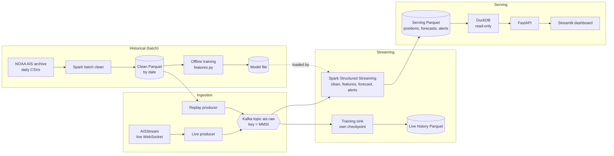

# NY Harbor Vessel Traffic Analytics: Project Plan

Course project for AAI 627 Big Data Analytics for Engineering Design (Fall 2026), Option 1: build a big data analytics app. Due in the first week of December 2026 (exact date unconfirmed).

## 1. Summary

A transportation analytics web app that tracks ship traffic in New York Harbor using public AIS data (the position reports vessels broadcast). A Spark pipeline cleans historical data from NOAA's open archive and a live AIS feed, then forecasts vessel arrivals and flags anomalies (signal gaps and off-route movement). Results appear on a dashboard with a live map, an arrival forecast, and an alert feed.

Analytics tasks covered: data cleaning, time-series forecasting, anomaly detection. Application area: transportation analytics.

## 2. Goals and Non-Goals

**Goals**
- A Spark batch pipeline that turns raw NOAA AIS data into clean, date-partitioned Parquet.
- A Kafka-based streaming path where live and replayed data share one topic and one consumer.
- An hourly arrival forecast evaluated against a seasonal-naive baseline on held-out data.
- Signal-gap and off-route alerts, with detection and false-alert rates measured on injected anomalies.
- A dashboard (live map, forecast chart, alert feed) working end to end.

**Non-goals**
- Collision avoidance, ETA prediction for individual vessels, or anything safety-critical.
- Production deployment, multi-node Spark clusters, or Kubernetes.
- Online (continuous) model learning and model-registry tooling.

## 3. Definitions (draft, finalize in week 1 from the data profile)

| Term | Draft definition | To calibrate |
| :-- | :-- | :-- |
| Harbor area | Bounding box around New York Harbor and its approaches | Box coordinates from the data profile |
| Geofence | Named polygon (harbor entrance, anchorage, terminal zones) | Which zones have enough traffic |
| **Arrival** | A vessel's first report inside a geofence after at least N minutes outside it; one count per vessel per visit | N, and which geofences to forecast |
| Forecast target | Arrivals per hour per geofence | Zone granularity |
| **Signal gap** | A vessel that was reporting regularly goes silent longer than a threshold. Class A AIS normally reports every few seconds while moving and about every 3 minutes at anchor, so the threshold must depend on vessel status | Draft from the 2-day profile (`docs/DATA_PROFILE.md`): 10 min under way, 30 min at anchor, moored, or status missing; fine-tune with more history |
| **Off-route** | A report in a grid cell whose historical traffic density is below a threshold, or far from a learned lane | Grid size, density percentile |

**Cleaning rules (draft, log row counts after each)**
1. Crop to the harbor bounding box first.
2. Drop rows with a missing or unparseable timestamp, MMSI, lat, or lon.
3. Drop invalid MMSIs (not 9 digits, or a non-vessel prefix such as base stations and aids to navigation).
4. Drop out-of-range positions (lat outside [-90, 90], lon outside [-180, 180]).
5. Set AIS "not available" codes to null: heading 511, speed over ground 102.3, course over ground 360.
6. Drop exact duplicates on (MMSI, timestamp).
7. Drop position spikes: a report whose implied speed from both the previous and the next report exceeds a threshold (calibrate from the profile). Checking both sides drops only the bad report, not the good one after it.

## 4. Architecture



Three paths share one cleaning and feature module (`pipeline/clean.py`, `pipeline/features.py`):
1. **Historical:** NOAA files are cleaned in batch into Parquet, which feeds offline training and the replay producer.
2. **Streaming:** the live and replay producers write the same message schema to `ais.raw`; one Spark streaming job cleans it, scores it with the trained model, and writes results to serving Parquet.
3. **Serving:** DuckDB reads the serving Parquet read-only; FastAPI and Streamlit sit on top.

| Component | Role |
| :-- | :-- |
| Live producer | Connects to the AIS WebSocket and publishes each message to `ais.raw` |
| Replay producer | Reads clean Parquet and publishes at accelerated speed; makes demos and anomaly tests reproducible |
| Kafka | Single broker, one topic `ais.raw` (3 partitions, key = MMSI), optional `ais.alerts` |
| Spark Structured Streaming | Consumes `ais.raw`, applies the **same cleaning and feature code** as the batch job, writes positions, forecasts, and alerts to serving Parquet |
| Training sink | A second streaming query with its own checkpoint (Spark tracks Kafka offsets in checkpoints, not consumer groups) that stores live history as Parquet for later retraining |
| Offline training | Reads features built from clean historical Parquet with the shared `features.py`; never reads Kafka |
| DuckDB | Queries the serving Parquet read-only. DuckDB allows one writer process, so the streaming job never writes to it directly |
| FastAPI and Streamlit | Thin API and dashboard |

**Streaming design notes**
- Structured Streaming does not support row-based window functions such as `lag`. Signal gaps and arrivals need per-vessel state: use `applyInPandasWithState` grouped by MMSI, with an event-time timeout and a watermark. A gap is the absence of messages, so the timeout is what fires the alert.
- Keying by MMSI keeps a vessel on one partition, but Spark does not preserve Kafka order through shuffles. Sort by the report's event timestamp inside the state function; never rely on arrival order.
- Run one source at a time (replay or live). Replay event times are months older than live ones and would break the watermark. Give each run its own checkpoint directory.
- The dashboard forecast runs on replayed data. Same-hour-last-week lags need a week of live history, so a live forecast is only possible once the training sink has collected it.
- Kafka runs in Docker and Spark on the host: set `advertised.listeners` to `localhost` so the host can connect.

## 5. Tech Stack

| Layer | Choice | Notes |
| :-- | :-- | :-- |
| Language | Python 3.11 | Pin early |
| Processing | Apache Spark 3.5.x (PySpark), local mode, Java 17 | Pin versions on day one; Java, Python, and PySpark mismatches are the most common time sink |
| Messaging | Apache Kafka, single broker, KRaft mode, Docker | Spark connector must match the Spark and Scala build (`spark-sql-kafka-0-10_2.12:3.5.x`) |
| Storage | Parquet partitioned by date; DuckDB for serving | |
| Geospatial | Rounded lat/lon grid built with native Spark expressions; Shapely only to map geofence polygons to grid cells once, offline | Pre-filter by bounding box. Open-source Spark has no built-in H3, so `h3` would run as a row-wise Python UDF |
| Forecasting | Spark aggregation, then scikit-learn or LightGBM on the small hourly series | Classical alternatives: SARIMAX, autoregressive Poisson |
| Anomaly detection | Batch: Spark window functions (time since last report). Streaming: `applyInPandasWithState`. Density grid for off-route; optional isolation forest | See streaming design notes in section 4 |
| API and UI | FastAPI, Streamlit with pydeck (or Folium) | |
| Orchestration | Scripts and a Makefile | No Airflow |
| Tooling | `uv` or `venv`, Git, pytest, Docker Compose | |

**Data sources** (links and verified details in `SOURCES.md`)
- Historical: NOAA / BOEM MarineCadastre AIS archive (large daily files; start with a limited date range). Verify current download format and column names.
- Live: a free AIS WebSocket service such as AISStream.io (needs an API key, has usage terms). Confirm New York Harbor coverage and terms before relying on it. Keep the key out of the repo.

## 6. Schedule

| Week | Dates | Focus | Status |
| :-- | :-- | :-- | :-- |
| 1 | Oct 19-25 | Data access, definitions, first preprocessing | Done; arrival and off-route definitions moved to weeks 3 and 4 |
| 2 | Oct 26-Nov 1 | Kafka setup, live ingestion, dashboard skeleton, historical pipeline | Done; screenshot for the deliverable pending |
| 3 | Nov 2-8 | More history, signal gap, replay feed, geofences and arrivals, baseline | |
| 4 | Nov 9-15 | Forecast model, off-route, evaluation | |
| 5 | Nov 16-22 | Dashboard and integration | |
| 6 | Nov 23-29 | Final checks and writeup | |
| 7 | Nov 30-Dec 6 | Buffer week | |

**Week 1 (Oct 19-25): Data access, definitions, first preprocessing**
- Project repo and environment setup
- Test the data source: get a sample set and produce the first cleaned Parquet
- Define "arrival" and "anomaly" (signal gap drafted from the data profile; arrival moved to week 3, off-route to week 4)

**Week 2 (Oct 26-Nov 1): Kafka setup, live ingestion, dashboard skeleton, historical pipeline**
Moved live ingestion and the dashboard skeleton here from weeks 3 and 5: the week 2 course deliverable is a screenshot of the app.
- Kafka broker and Spark pipeline
- Live Kafka producer on the live AIS feed
- Dashboard skeleton: live map of latest vessel positions, reading serving Parquet through DuckDB (FastAPI added later)
- Shared cleaning module and batch cleaning job on the historical sample

**Week 3 (Nov 2-8): More history, signal gap, replay feed, geofences and arrivals, baseline**
The heaviest week; listed in dependency order. If it runs over, the baseline moves to the start of week 4.
- Download and clean 2-4 consecutive weeks of NOAA data (`make download`, `make clean-data`); arrivals and the baseline need it
- Rule-based signal-gap detector in batch and streaming (stateful); this is the main gap detector, not only a baseline
- Replay producer for Spark (moved from week 2)
- Choose geofences and the arrival window N, then count arrivals per hour (moved from week 1)
- Check the harbor bounding box against the data: is traffic cut off at the edges? (moved from week 1)
- Seasonal-naive baseline for the arrival forecast
- Read AISStream's terms and rate limits in a browser; find out whether one report per vessel per minute is throttling or coverage (open question 3)

**Week 4 (Nov 9-15): Forecast model, off-route, evaluation**
- Offline training on clean historical features; forecast evaluated against the baseline
- Off-route alerts, after choosing the grid size and density percentile from the data (moved from week 1)
- Detection and false-alert rates for both detectors on injected test anomalies
- Optional: isolation forest compared on the same injected set
- No new features after Nov 15

**Week 5 (Nov 16-22): Dashboard and integration**
- Live map, forecast chart, and alert feed, working end to end

**Week 6 (Nov 23-29): Final checks and writeup**
- Results, architecture diagram, rehearsed demo

**Week 7 (Nov 30-Dec 6): Buffer week**
- Final fixes and submission

Notes:
- Thanksgiving is Nov 26, so week 6 is a light week. Aim to be demo-ready by about Nov 25.
- The buffer ends Dec 6; confirm the real due date, since it may fall earlier in that week.
- Training sink (live history to Parquet): build it only if the course requires it (open question 6); week 3 has no room for it.
- The dashboard skeleton (week 2) runs on live data; extend it during weeks 3 and 4 so week 5 is integration, not construction.

## 7. Checkpoints (go/no-go gates)

| Date | Gate | If missed |
| :-- | :-- | :-- |
| Oct 25 | Data is usable, with numbers: enough reports per hour in the harbor box for hourly arrival counts, and regular enough report intervals for gap detection (**passed Oct 28** on 2 NOAA days, `docs/DATA_PROFILE.md`: median 278-412 vessels per hour in the box; p99 report interval about 90 s under way and 540 s at anchor or moored. Arrival counts per geofence not yet checked) | Change geofence, vessel filter, or date range now |
| Oct 30 | Kafka reads into Spark (**passed Oct 28**: live producer to `ais.raw` to Structured Streaming to Parquet; the file-stream fallback was never built and is dropped) | Fall back to a folder-based file stream and retry Kafka in week 3 |
| Nov 15 | Feature freeze | Cut scope; only fixes and polish after this date |

## 8. Evaluation Plan

**Arrival forecast**
- Target: hourly arrivals per geofence.
- Baseline: seasonal-naive (same hour last week; also test same hour yesterday).
- Split: time-based (train on earlier weeks, test on later weeks). Rolling-origin evaluation if time allows.
- Metric: MAE and RMSE on the same hours as the baseline. Reporting "model does not beat the baseline" is an acceptable, honest result.

**Anomaly detection**
- No ground-truth labels exist, so evaluate on **injected anomalies**: delete a stretch of one vessel's reports (gap) or shift a track sideways (off-route), on a separate evaluation path never used for training.
- Metrics: detection rate (recall) on injected anomalies and false-alert rate on unmodified traffic.
- Compare the rule-based detector with an optional isolation forest on the same injected set.

## 9. Risks and Mitigations

| Risk | Mitigation |
| :-- | :-- |
| Live feed unavailable, restricted, or quiet during the demo | Replay producer shares the same topic and consumer; demo from replay if needed |
| Historical files too heavy | Start with one to two months or a few days per season; Parquet with date partitioning |
| "Off-route" has no ground truth | Define it as deviation from learned density, state that choice, and evaluate on injected anomalies |
| Forecast barely beats the baseline | Choose a target with enough signal (hourly counts per zone); report honestly |
| Spark feels oversized for the data | Process enough history that Spark does real work; use Structured Streaming for the live path |
| Kafka and Spark version mismatch | Pin versions in week 1; match the connector package to the Spark and Scala build |
| Geospatial joins are slow | Pre-filter by bounding box; use a rounded lat/lon grid and map geofences to grid cells |
| Stateful streaming (gaps, arrivals) is harder than batch | Get the batch version right first with tests, then port the same rule to `applyInPandasWithState` |
| DuckDB lock errors between writer and API | Streaming writes Parquet only; the API reads it through DuckDB read-only |
| Dashboard consumes the schedule | Use Streamlit; build the skeleton on mock data early |
| Training-serving skew | One shared feature module imported by batch, streaming, and training |

**If time runs short, cut in this order:** off-route alerts (keep the signal-gap rule), then the live feed (demo from replay), then forecast tuning (keep the baseline plus one model).

## 10. Repository Layout

```
vessel-watch/
  CLAUDE.md
  docs/PROJECT_PLAN.md
  README.md
  docs/SOURCES.md           # data source links
  Makefile
  docker-compose.yml        # Kafka broker
  pyproject.toml            # pinned dependencies (uv.lock alongside)
  config.yaml               # paths, topics, bounding box, thresholds
  data/                     # git-ignored: raw, clean, checkpoints, serving, models
  ingest/
    noaa_download.py
    live_client.py          # live producer
    replay.py               # replay producer
  pipeline/
    config.py               # loads config.yaml
    clean.py                # shared cleaning logic
    features.py             # shared feature logic
    batch_job.py
    stream_job.py
    training_sink.py
  models/
    forecast.py
    anomalies.py
    inject.py               # synthetic anomaly injection (evaluation only)
  api/
    main.py
  app/
    dashboard.py
  tests/
    test_clean.py
    test_anomalies.py
    test_features.py
```

## 11. Open Questions

1. Exact due date and any earlier checkpoints (proposal, midterm demo). Known so far: a week 2 deliverable needs a screenshot of the app.
2. Is a written report or presentation a separate deliverable, and what format?
3. Does the chosen live feed cover New York Harbor, and what are its rate limits and terms?
4. Which geofences have enough traffic to forecast hourly arrivals?
5. Spark MLlib or scikit-learn/LightGBM for the forecast (state the reason in the report)?
6. Does the course require the Kafka-to-Parquet training branch? If not, the training sink can be dropped, since training already uses clean historical Parquet.

## 12. Report Outline (week 6)

1. Problem and goals
2. Data and definitions (arrival, anomaly)
3. Architecture (Kafka topics, keys, partitions, Spark jobs, training branch)
4. Methods (cleaning, features, baselines, models)
5. Evaluation (forecast vs. baseline, anomaly rates on injected data)
6. Dashboard and demo
7. Limitations and future work (nonlinear models, richer off-route detection, multi-broker Kafka)
